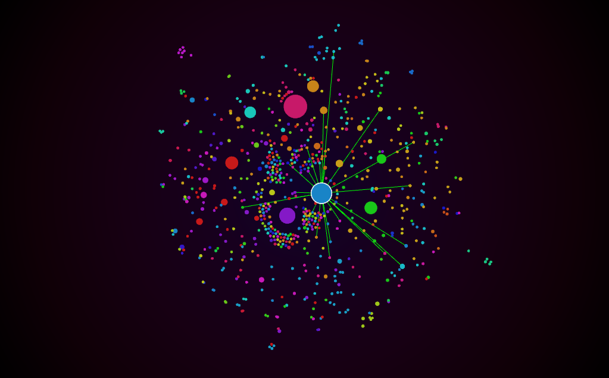

# regl-graph

Biblioteca para geração de grafo (rede) interativo, utilizando [regl](https://github.com/regl-project/regl).

[https://rogeriocastro.github.io/regl-graph/](https://rogeriocastro.github.io/regl-graph/)

<p align="center"></p>

## Instalação

Baixe o arquivo de produção da biblioteca que está localizado no diretório [`/dist`](/dist) e acrescente-o à `HEAD` da página. 

```html
<head>
  ...
  <script src="regl-graph.min.js"></script>
  ...
</head>
```

## Utilização

Inclua uma `DIV` no local desejado da página, especificando o `id` desejado e suas largura (*width*) e altura (*height*).

Ao final do corpo da página insira o script de chamada da biblioteca.

```html
<body>
  <style>
    #main {
      width: 100%;
      height: 100%;
    }
  </style>
  <div id='main'></div>
  <script>
    const data = {
      nodes: [
        // Array de nós
      ],
      edges: [
        // Array de arestas
      ]
    };
    // Gerando a rede
    const graph = new reglGraph(document.getElementById('main'), data, { containerMargin: 20 })
  </script>
</body>
```

## API

```javascript
const graph = new reglGraph(container, data, options);
```

`container` é o elemento HTML onde o grafo será impresso. Pode ser uma chamada direta à função `document.getElementById('main')`.

`data` é um objeto que contém propriedades `nodes` e `edges`, com os dados dos nós e arestas, respectivamente.

```javascript
const data = {
  nodes: [
    {
      id: "test0",
      label: "test",
      y: -404.26147,
      x: -739.36383,
      size: 4.725,
      color: "#4f19c7",
      attributes: {
        // ...
      },
    },
    // ...
  ],
  edges: [
    {
      sourceID: "test0",
      targetID: "test1",
      size: 1,
      attributes: {
        // ...
      }
    },
    // ...
  ]
};
```

`options` é um objeto que contém propriedades de configuração do grafo.

A instância criada com `new reglGraph(container, data, options)` pode ser utilizada para gerenciar algumas características da instância e para o gerenciamento dos eventos disparados pela biblioteca.

### Propriedades do objeto `options`

| Propriedade | Descrição |
| ----------- | --------- |
| `graphMargin` | Margem interna do grafo. Valor padrão: `50`. |
| `showEdges` | Habilita ou desabilita a plotagem das aresta do grafo. Valor padrão: `true`. |
| `showEdgesOnMove` | Habilita ou desabilita a plotagem das aresta durante a movimentação do grafo (clicar e arrastar). Valor padrão: `false`. |
| `nodesSizeRange` | Extensão de valores mínimo e máximo para o tamanho dos nós. Valor padrão: `[5, 30]`. |
| `edgesWeightRange` | Extensão de valores mínimo e máximo para a espessura das arestas. Valor padrão: `[1, 5]`. |
| `defaultNodesOpacity` | Opacidade padrão para plotagem dos nós. Valor padrão: `1`. |
| `defaultEdgesOpacity` | Opacidade padrão para plotagem das arestas. Valor padrão: `0.05`. |
| `defaultEdgesColor` | Cor padrão (formato CSS) para plotagem das arestas em caso de não haver a propriedade `color` especificada no objeto da aresta. Valor padrão: `'#FFFFFF'`. |
| `containerMargin` | Margem a ser aplicada ao container HTML. Valor padrão: `0`. |
| `zoomExtent` | Extensão de valores mínimo e máximo para o nível de zoom. Valor padrão: `[1, 500]`. |
| `highlightedNodeScale` | Escala de tamanho a ser aplicada no nó realçado (sobreposto pelo mouse). Valor padrão: `1.1`. |
| `selectedNodeBorderColor` | Cor da borda do nó selecionado. Valor padrão: `'rgb(255,255,255)'`. |
| `selectedNodeBorderSize` | Espessura da borda do nó selecionado. Valor padrão: `3`. |
| `tooltipAttributes` | *Array* com os nomes de atributos dos nós que devem ser exibidos nas *tooltips*. Essa propriedade será descartada se `tooltipFormat` for informado. Valor padrão: `[]`. |
| `tooltipFormat` | Função de formatação do conteúdo da *tooltip*. Essa função receberá um objeto com os dados do nó e deve retornar uma *string* que pode conter HTML `(node) => 'content'`. Se essa propriedade não for informada, a formatação padrão da biblioteca será utilizada e a opção `tooltipAttributes` será considerada. |
| `log` | Habilita ou desabilita a exibição de *logs* da biblioteca no *console* do navegador. Valor padrão: `true`. |

### Eventos

```javascript
const graph = new reglGraph(container, data, options);

// Atribuindo uma função ao evento clique
graph.on('nodeselect', (node) => {
  console.log('Nó selecionado:', node)
});
```

Os *event listeners* são atribuídos por meio da instância, com a função `on(eventName, callbackFunction)`.

| Evento | Descrição |
| ------ | --------- |
| `nodeselect` | Evento disparado quando um nó é selecionado. Recebe como argumento um objeto com os dados do nó selecionado. Ex.: `graph.on('nodeselect', (node) => {})` |
| `click` | Evento disparado em qualquer clique na área do grafo. Recebe como argumento um objeto com evento e o nó, quando o clique for sobre um nó, caso contrário recebe um valor nulo como nó. Ex.: `graph.on('click', ({ event, node }) => {})` |
| `nodeover` | Evento disparado quando um nó é sobreposicionado pelo mouse. Recebe como argumento um objeto com os dados do nó. Ex.: `graph.on('nodeover', (node) => {})` |
| `nodeout` | Evento disparado quando um nó é deixado pelo mouse. Recebe como argumento um objeto com os dados do nó. Ex.: `graph.on('nodeout', (node) => {})` |
| `zoom` | Evento disparado quando o grafo é movido ou o nível de zoom é alterado. Recebe como argumento um objeto com os dados da transformação. Ex.: `graph.on('zoom', ({ x, y, z }) => {})` |

### Objeto do nó (node)

O objeto do nó fornecido como argumento nos eventos e na função de formatação de *tooltip* contém o seguinte formato:

```javascript
{
  id: "test",
  // Array de arestas ligadas ao nó
  links: [
    {
      fromId: "grunt",
      toId: "test",
      data: {
        "weight": 1,
        "color": "#00FF00",
        "index": 68
      },
      id: "grunt👉 test"
    },
    // ...
  ],
  // Atributos do nó
  data: {
    color: "#19c719",
    label: "test",
    y: -265.6326,
    x: 694.03375,
    index: 39,
    position: [
      606.1902,
      266.2653,
      39
    ],
    size: 13.2722
  }
}
```

### Funções da instância

```javascript
const graph = new reglGraph(container, data, options);

/* Reseta zoom e pan aplicando uma transição leve, retomando o estado de visualização inicial */
graph.reset();

/* 'getOption' Retorna as configurações da biblioteca ou todas se nada for informado como argumento */
const defaultEdgesColor = graph.getOption('defaultEdgesColor');
const allOptions = graph.getOption();

/* Atribui ou modifica uma configuração do grafo e chama a renderização */
graph.setOption('defaultEdgesColor', '#FF0000')

/* Deleta o grafo e limpa os objetos da memória */
graph.dispose()

/* Destaca nós de uma lista de IDs */
graph.highlight(['underscore', 'async'])

/* 'getAppInstance' Retorna algumas instâncias importantes da biblioteca */

// Instância do objeto regl (https://github.com/regl-project/regl)
const regl = graph.getAppInstance('regl');

// Instância do modelo do grafo (https://github.com/anvaka/ngraph.graph)
const graphModel = graph.getAppInstance('graph');

// Instância da tooltip (https://github.com/atomiks/tippyjs)
const tooltip = graph.getAppInstance('tooltip');

// Elemento canvas
const canvas = graph.getAppInstance('canvas');
```

## Desenvolvimento

Essa biblioteca foi desenvolvida utilizando [webpack](https://webpack.js.org/) para o empacotamento.

```bash
# Dependências
$ npm install

# Servidor de desenvolvimento (localhost:9000)
$ npm start

# Build de produção
$ npm run build
```

> O comando `npm run build` irá gerar os arquivos da biblioteca `regl-graph.min.js`, `regl-graph.min.js.map` e `regl-graph.min.js.LICENSE.txt` no diretório [`/dist`](/dist).

## License

MIT &copy; Rogério Castro
